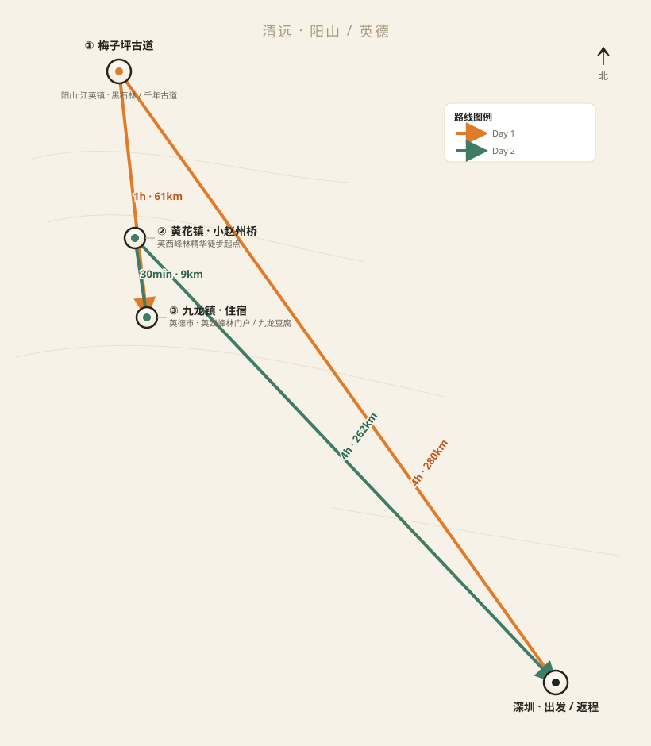

# 清远·梅子坪古道 × 英西峰林 徒步自驾游攻略

> 广东版「墨石公园」千年古道 × 「英西小桂林」喀斯特画廊 · 周末两日精华徒步

## 出行概览

| 项目 | 内容 |
|------|------|
| 出发地 | 深圳 |
| 目的地 | 清远市阳山县·英德市（梅子坪古道 + 英西峰林走廊） |
| 出行日期 | 2026-11-14（周六）至 2026-11-15（周日），共 2 天 |
| 同行人 | 5 人（一对情侣 + 一男两女） |
| 出行方式 | 自驾（1 车，建议 SUV/空间大的轿车） |
| 行程主题 | 喀斯特地貌轻徒步 × 秋日山野摄影 |
| 徒步强度 | 适中（每天 8–10km，爬升小，全程免费） |
| 总预算 | 约 1500–1750 元（人均 300–350 元，详见预算） |

**一句话路线**：周六先深入阳山走「广东版墨石公园」梅子坪千年古道，傍晚转场英西峰林门户九龙镇住宿；周日沿「英西小桂林」精华徒步线穿行峰林田园，下午返程深圳。

---

## 路线总览

### 行程串联图（里程/车程均经 OSRM 路由实测验证）

```
Day1   [深圳] ──4h·280km──▶ [梅子坪古道·黑石林] ──1h·61km──▶ [九龙镇·住宿]
Day2   [九龙镇] ──30min·9km──▶ [黄花镇·小赵州桥] ──徒步10km──▶ [和顺岩→观音谷] ──返程──▶ [深圳]（九龙镇直返 4h·262km）
```

### 行程示意图



### 路线里程表

| 日程 | 日期 | 起点 → 终点 | 里程 | 预计车程 | 住宿地 |
|------|------|------------|------|---------|--------|
| Day 1 | 11.14 | 深圳 → 梅子坪古道 | 280 km | ~4h | 九龙镇 |
| Day 1 | 11.14 | 梅子坪古道 → 九龙镇 | 61 km | ~1h | 九龙镇 |
| Day 2 | 11.15 | 九龙镇 → 黄花镇（小赵州桥） | 9 km | ~30min | — |
| Day 2 | 11.15 | 黄花镇 → 深圳（九龙镇直返） | 262 km | ~4h | — |
| **合计** | | | **约 612 km** | **约 9.5h 车程** | |

> 里程与车程为 OSRM 理想路况结果，实际驾驶按 +25%~30% 预留缓冲；山区县道请再放宽。

---

## 逐日行程

### Day 1（11.14 周六）：梅子坪古道 · 黑石秘境

**主题**：一脚踏进千年古道，看尽「广东版墨石公园」连片黑石林 + 秋日黄叶

**时间轴**

| 时间 | 行程 | 备注 |
|------|------|------|
| 06:30 | 深圳出发 | 出发前加满油，带上干粮早餐 |
| 10:45 | 抵达梅子坪古道起点 | 导航「阳山县江英镇上坪村党群服务中心」，村口免费停车；登山口更近可导「周屋农庄」 |
| 11:00 | 开始徒步 · 8km 精华小环线 | 全程爬升约 300m，3.5–4.5 小时（含拍照） |
| 12:00–13:00 | 古道午餐 | 黑石林旁野餐（自带），或到梅子坪村/邓公村小卖部补给豆腐花、绿豆沙（**务必带现金**） |
| 13:00–15:00 | 精华段打卡 | 黑石林核心区（墨石公园机位）、青石板马蹄印古道、梯田古村、牛羊群 |
| 15:00 | 收整返车 | 务必 15:30 前下山，山区无路灯天黑快 |
| 15:30–16:30 | 车程至九龙镇 | 61km，县道为主，慢行 |
| 16:30 | 入住九龙镇客栈 | 英西峰林门户，餐饮选择多 |
| 17:30–19:00 | 晚餐 | 九龙豆腐农家菜（见美食推荐） |
| 可选 | 千军峰林 / 荣强小桂林日落 | 九龙镇西南约 2km，免费，光线极佳 |

**今日强度**：车程约 5h + 徒步约 4h，属偏充实的一天；建议前一晚早睡、当天早餐吃饱。

---

### Day 2（11.15 周日）：英西峰林 · 喀斯特画廊

**主题**：穿行「英西小桂林」，打卡小赵州桥→和顺岩→观音谷精华徒步线

**时间轴**

| 时间 | 行程 | 备注 |
|------|------|------|
| 08:30 | 退房出发 → 黄花镇 | 9km / 30min，导航「黄花公园」（小赵州桥所在地） |
| 09:00 | 英西峰林精华徒步开始 | 全程约 10km，机耕路+乡道，几乎无爬升，3.5–5 小时 |
| 09:15 | 小赵州桥（永丰古桥） | 无桥墩古石拱桥，蔓藤古意，打卡经典机位 |
| 09:30 | 永丰古庙 | 顺路古庙，可稍作停留 |
| 10:30–11:30 | 和顺岩 | 天然穿山岩洞，溪流穿洞，拍剪影绝佳 |
| 11:30–12:30 | 观音谷 | 群峰环抱，奇石「童子拜观音」，草坪休整午餐 |
| 12:30–13:30 | 返程回黄花公园 | 观音谷口三轮摩托回程约 5 元/人，或原路折返 |
| 13:30–14:30 | 九龙镇午餐 | 下山农家菜（见美食推荐） |
| 15:00 | 九龙镇出发返深 | 262km / 约 4h |
| 19:00 | 抵达深圳 | 顺利到家 |

**今日强度**：徒步约 4h（无爬升）+ 车程约 4.5h，节奏适中。

> 时间富余的话，可在九龙镇顺路打卡 **洞天仙境**（穿天岩，门票约 85 元，船游 1.5h）或**公正溪村峰林倒影**（免费）。预算紧张可选后者。

---

## 徒步路线详解

> 两条徒步线全程免费。出发前务必在「两步路」App 下载对应离线轨迹：搜「清远梅子坪古道」「英西峰林 黄花 观音谷 徒步」。

### ① 梅子坪古道 · 8km 精华小环线（Day 1）

| 分段 | 里程 | 用时参考 | 说明 |
|------|------|---------|------|
| 上坪村起点（免费停车） | 0km | — | 登山口更近可导「周屋农庄」/「沙磅」；热身出发 |
| 千年青石板古道 | 约1.5km | 20min | 马蹄印石板路，林荫段，平缓 |
| 黑石林核心区（最高点≈455m） | 约3km | 1h | 「广东版墨石公园」连片黑石，拍照机位 |
| 梅子坪村 / 邓公村 | 约5km | 1h | 补给点（豆腐花/绿豆沙，带现金）；梯田古村、牛羊 |
| 梯田观景台 → 返回起点 | 约8km | 1h | 下山梯田路段，**17:00 前回到车旁** |

- **总长**：8–9km 环线｜**爬升**：约 300m（最高海拔约 455m）｜**用时**：3.5–4.5h｜**难度**：★☆
- **轨迹**：「两步路」搜索「清远梅子坪古道」，下载离线轨迹；全程约 90% 无信号
- **补给**：山中补给点只收现金；自备 1.5–2L 水 + 路餐

### ② 英西峰林 · 黄花精华线（Day 2）

| 分段 | 里程 | 用时参考 | 说明 |
|------|------|---------|------|
| 黄花公园 / 小赵州桥 | 0km | — | 停车场；打卡古石拱桥后出发 |
| 永丰古庙 → 骆驼峰 / 攀岩场 | 约2km | 30min | 乡间小路，沿途茶园、田园 |
| 和顺岩（穿山岩洞） | 约5km | 1.5–2h | 天然穿洞，溪流穿洞，拍剪影 |
| 观音谷 | 约7km | +40min | 群峰环抱谷地，草坪午餐休整 |
| 返程回黄花公园 | 约10km | 30min | 观音谷口三轮摩托≈5元/人，或原路折返 |

- **总长**：约 10km（单程至观音谷后返程）｜**爬升**：几乎无（机耕路+乡道）｜**用时**：3.5–5h｜**难度**：★★☆
- **防晒**：全程基本无遮荫，务必防晒帽 + 墨镜 + 防晒霜，每人 1.5L 以上水
- **轨迹**：「两步路」搜索「英西峰林 黄花 观音谷」下载离线轨迹备用

## 景点详情

### 梅子坪古道（Day 1 主徒步）

- **位置**：清远市阳山县江英镇，与英德市大湾镇交界（古道横跨两县）
- **门票**：免费，无需预约
- **徒步里程**：8–9km 环线｜爬升约 300m｜最高海拔约 455m
- **用时**：3.5–4.5 小时（含拍照休息）
- **难度**：★☆（平缓青石板+土路为主，几乎无陡坡，新手友好）
- **亮点**：广东目前最大连片**阳石林（黑色喀斯特石林）**，被誉为「广东版墨石公园」；千年**青石板古驿道**上马蹄印犹在；原始梯田古村、黑山羊与黄牛群；11 月中下旬至 12 月**秋日黄叶**最佳观赏期
- **最佳观赏时段**：上午 8:00–11:00（光线柔和、黑石质感强）；午后光线更适合拍梯田
- **导航**：阳山县江英镇上坪村党群服务中心（免费停车）；登山口更近可导「周屋农庄」
- **补给**：梅子坪村、邓公村有小卖部（豆腐花/绿豆沙/烤肠），**建议带现金**
- **信号**：90% 路段无信号，务必在「两步路」App 提前下载离线轨迹（搜索「清远梅子坪古道」）
- **购票**：无需购票
- **注意**：石板路湿滑需穿防滑徒步鞋；下午 15:30 前下山；垃圾全部带走

### 英西峰林 · 黄花精华徒步线（Day 2 主徒步）

- **位置**：清远英德市九龙镇、黄花镇（英西峰林走廊核心区）
- **门票**：徒步全线免费
- **徒步路线**：黄花公园（小赵州桥）→ 永丰古庙 → 骆驼峰/攀岩场 → 和顺岩 → 观音谷，约 10km
- **用时**：3.5–5 小时
- **难度**：★★☆（机耕路+乡道，基本无爬升，防晒是关键）
- **亮点**：**小赵州桥**（按力学原理垒石而成、无桥墩的古石拱桥，爬满蔓藤）；**和顺岩**（长约 200m 天然穿山岩洞，乡道从洞中穿过，溪流潺潺）；**观音谷**（群峰环抱的谷地，「童子拜观音」奇石）；沿途峰林田园、倒影、茶园
- **最佳观赏时段**：清晨/傍晚光线柔和；晴天上午峰林轮廓最清晰
- **导航**：黄花公园 / 小赵州桥（黄花镇黄花公园内，有停车场）
- **返程**：观音谷可拦三轮摩托车返回黄花公园（约 5 元/人），或原路折返
- **拍照**：明迳倒影（黄花驿站旁）、公正溪村峰林倒影（免费，X366 县道旁）
- **注意**：全程多无遮荫，需防晒（帽子+墨镜+防晒霜）；带 1.5L 以上水；驱蚊液

### 九龙镇（Day 1 住宿 / Day 2 中转）

- **位置**：英德市西南部，英西峰林走廊门户，S348 省道贯穿
- **亮点**：千军峰林（全镇西南约 2km，免费）、洞天仙境（穿天岩，85 元可选）、九龙豆腐（清远非遗）
- **住宿**：经济型客栈/民宿为主，旺季 120–200 元/间
- **餐饮**：农家菜馆众多，本地菜集中

---

## 住宿推荐

| 日期 | 住宿地 | 推荐类型 | 价格区间（参考） | 说明 |
|------|--------|---------|----------------|------|
| 11.14 | 英德市九龙镇 | 经济型客栈/宾馆 | 120–200 元/间 | 5 人建议 3 间，步行可达九龙大道餐饮街；预算紧张可 2 间拼住 |

> 九龙镇离 Day2 徒步起点黄花镇仅 9km（30 分钟），住九龙餐饮方便、性价比高。也可考虑黄花镇民宿（更靠近徒步起点，但选择少、餐饮弱）。
> **预订建议**：11 月中为徒步旺季，请提前 1 周在携程/美团预订并电话确认。

---

## 美食推荐

### 九龙镇（英西峰林）
- **九龙豆腐**（非遗）：水嫩清甜，必尝。推荐：镇内农家菜馆的「九龙豆腐煲」
- **清远走地鸡**：白切/柴火焖煮，肉质紧实
- **山坑螺 / 河煎小鱼仔**：下饭下酒
- **腐竹**：当地特产，可带手信

### 梅子坪古道沿途
- 上坪村/梅子坪村小卖部：**山水豆腐花**、绿豆沙、菜包（5 元内，记得带现金）
- 终点邓公村周边农庄：清远鸡、农家土菜

### 徒步路餐
- 自备：全麦面包、能量棒、坚果、香蕉、牛肉干；每人 1.5–2L 水（梅子坪山中补给有限）

---

## 预算估算（5 人 · 1 车，按 3 间经济房）

| 项目 | 金额（元） | 备注 |
|------|-----------|------|
| 油费 | ≈ 360 | 全程约 630km × 7.5L/100km × 约 7.6 元/L |
| 高速过路费 | ≈ 330 | 深圳→梅子坪、九龙→深圳两段长途高速为主 |
| 住宿 | 360–450 | 3 间 × 120–150 元/晚 |
| 餐饮 | ≈ 550 | 2 次农家菜正餐 + 早餐 + 徒步干粮 |
| 门票 | 0 | 两条徒步线均免费 |
| 其他 | ≈ 100 | 补给、停车、保险、三轮车返程 |
| **合计** | **≈ 1700–1790** | **人均 ≈ 340–360 元** |

**省钱到人均 300 元的小技巧**：
- 住宿改 2 间拼住（省 120 元）
- 午餐两餐以自带干粮/简餐为主，正餐留 2 顿（省 100 元）
- 返程走九龙镇直返，少 20 分钟车程
- 高速尽量错峰，避开周末上午 8–10 点拥堵

---

## 出行贴士

- **天气**：11 月中旬清远 15–25℃，昼夜温差大，山区体感更凉。**出发前查「阳山」「英德」天气预报**；如预报有雨，梅子坪石板路湿滑，请改期或改走英西峰林（土路为主）。带上轻便雨衣。
- **交通**：主要走广深/京港澳 → 广清高速（许广）→ 清连高速 → 阳山段，进村最后一段窄路，会车慢行；梅子坪→九龙段为县道，多弯道注意安全；山区 18:00 后天黑快，务必在天黑前下山。
- **装备**：防滑徒步鞋（青石板/湿滑路段）、登山杖、护膝、防晒帽+墨镜+防晒霜、驱蚊液、每人 1.5–2L 水、头灯/手电、薄外套（防风防温差）。
- **信号与导航**：梅子坪 90% 路段无信号——提前在「两步路」下载「清远梅子坪古道」离线轨迹；离线下载地图；**现金**（山中补给点只收现金）。
- **环保与安全**：无痕山野，垃圾全部带走；不攀爬石林；不采摘野果野菜；结伴同行不落单；防火（秋冬草木干燥，禁止野外生火）。
- **应急**：报警 110 / 急救 120；出发前将行程发给家人；如迷路尽量原地等待、保持通讯设备电量；梅子坪起点上坪村有党群服务中心可求助。
- **停车**：梅子坪上坪村口免费停车场，周末早到（建议 10:30 前）占位；黄花公园有停车场。

---

## 交付文件与分享方式

| 文件 | 用途 | 说明 |
|------|------|------|
| `清远梅子坪-英西峰林自驾游攻略.html` | 本地编辑版 | 图片引用同目录 `images/` 文件夹，需整个文件夹一起保留 |
| `清远梅子坪-英西峰林自驾游攻略-分享版.html` | **发给队友 / 跨设备打开** | 所有图片（含封面）已压缩并以 base64 内嵌，**单文件约 8.7MB，离线可看** |
| `route.svg` | 路线示意图源文件 | Markdown 版引用 |
| `images/` | 实拍配图（17 张） | 原始分辨率，供编辑版使用 |

> ✅ 分享给他人时**只需发送「分享版」这一个 HTML 文件**，微信 / QQ / 邮件附件均可，对方双击就能看到完整图文，不需要 `images` 文件夹，也不需要联网。
> 📌 唯一需要联网的是「真实地图」的瓦片底图；无网络时页面会自动提示，并可在「行程示意图」查看同样的路线。

---

## 参考资料

1. 景点信息：Trip.com 阳山/英德游记、什么值得买《清远梅子坪古道攻略》、两步路社区《英德梅子坪穿越阳山江英古道》、磨房《英西峰林徒步和阳岩洞攻略》、中新网《广东梅子坪：千年古道穿石林》
2. 坐标：Wikipedia（江英镇 24.506N/112.839E、大湾镇 24.339N/112.946E）、高德 POI（九龙镇九龙大道 24.139N/112.920E、小赵州桥 24.203N/112.912E）
3. 里程/车程：OSRM 开源路由 API（router.project-osrm.org）实测验证，实际按 +25%~30% 缓冲
4. 天气：清远气候资料、2026 年 11 月阳山/英德历史与预报参考
5. 图片来源：HTML 版配图主要为 **B站实拍视频封面**（梅子坪古道 / 小赵州桥 / 和顺岩 / 英西峰林 / 九龙镇 / 洞天仙境等对应景点真实画面，每张已标注视频 UP主），已下载至 `images/` 本地文件夹随攻略一起使用；另有少量 Pexels 美食示意图；版权归原作者，仅作行程参考

> ⚠️ 本攻略为信息整合与路线规划参考，徒步属户外活动，存在风险；请根据队员体能、天气、路况自行判断与调整，安全第一。
